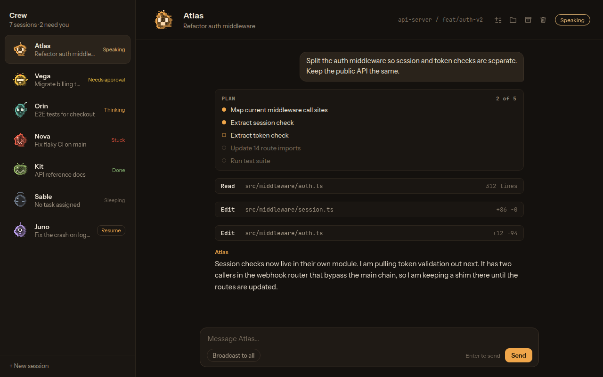

<p align="center"></p>

<h1 align="center">Agent Crew</h1>

<p align="center">A desktop control room for a crew of Claude Code agents working in parallel.</p>



Each robot in the sidebar is a Claude Code agent with its own task, its own git worktree and a live status. Pick one
to see its plan, its tool calls with diffs, and its replies as they stream. When an agent wants to do something risky,
it asks on an approval card in the app, and the sidebar counts who needs you.

> [!IMPORTANT]
> **Unofficial.** Agent Crew is an independent project, not made or endorsed by Anthropic. It runs the `claude` you
> installed and signed in to yourself. It never asks for, reads or stores your Claude credentials, and it doesn't use
> an API key. If you sign in with a Pro or Max plan, check that this use fits
> [Anthropic's terms](https://code.claude.com/docs/en/legal-and-compliance).

## Built on Paseo

The agent engine inside Agent Crew is **[Paseo](https://github.com/getpaseo/paseo)**, the open-source agent engine by
Mohamed Boudra (Apache-2.0). Paseo does the hard part: it runs Claude Code through the Agent SDK, turns its output into
typed events (plans, tool calls with diffs, approval requests), creates the git worktrees, and lets the app catch up
after a reconnect. Thank you to the Paseo project for making it open.

Agent Crew vendors Paseo **v0.15.4** unchanged in [`engine/vendor/paseo`](engine/vendor/paseo) (see
[`engine/VENDORED.md`](engine/VENDORED.md)) and applies a small patch series on top, in
[`engine/patches`](engine/patches). The patches tighten the engine's defaults for a desktop app: a password is always
required, there's no permission-bypass mode, repos can't grant themselves powers, and nothing talks to outside
services. Agent Crew adds the desktop app around it: the crew, the faces, the approval cards and the Electron security
setup. [The engine](#the-engine) below has the details.

## What it does

- **The crew:** twelve robots, each with its own face and manner. A new install starts with the six from the design;
  any other robot joins when you give it a session.
- **Rename and delete:** click a robot's name in the header (or press F2) to rename it. The trash button deletes it
  from the crew: its session and conversation go, its worktree is removed if you choose, and its branch is kept. Names
  and who's in the crew are kept in `crew.json` in the app's data folder.
- **New session dialog:** pick a free robot, a task, a project folder (and its base branch, for a git repo), the model
  and the permission mode. Under "More options" you can add extra folders, allow rules and "Trust this repo's Claude
  settings". Anything that gives a robot more than the defaults is confirmed in a native dialog the page can't answer.
- **How a robot works:** in a git repo, in its own worktree (branch `crew-<robot>-<task>`). In a folder that isn't a git
  repo, directly in the folder, after you confirm in a native dialog: there's no branch, and its Changes view lists the
  edits it made with its file tools. Never your whole home folder, the disk or the app's own data. Either way you get
  live plan cards, tool rows, streamed replies and approval cards. Esc stops it. Typing a task to a sleeping robot
  still works too: you're asked for a folder.
- **Notifications:** a desktop notification when a robot needs your approval or gets stuck while the window isn't in
  front. Clicking it shows that robot.
- **Session header:** Changes (the diff against the base branch, plus new files), Open folder, Archive and Delete.
  Archive puts the robot back to sleep; it asks whether to remove the worktree, and always keeps the branch.

**Not yet:** agents on other machines over SSH, and builds for macOS and Windows.

## Get started

### What you need

- **Node.js 22 or newer** (with npm) and **git**.
- **Claude Code**, installed and signed in to your own account:

  ```bash
  curl -fsSL https://claude.ai/install.sh | bash
  claude auth login
  ```

### Linux

Tested on Ubuntu with GNOME (Wayland), x64.

```bash
git clone https://github.com/alaatawalbeh/agentcrew.git
cd agentcrew
npm install              # also downloads Electron
npm run engine:prepare   # copies the vendored Paseo engine to engine/work and applies the patches
npm run engine:build     # installs the engine's dependencies and compiles it
npm run build            # typecheck + production build
npm start                # opens Agent Crew
```

To get an app you can launch from your app menu, build the AppImage and add it to the menu (this also gives it its
icon in the dock):

```bash
npm run package          # release/Agent-Crew-<version>-x86_64.AppImage
npm run install-desktop  # adds Agent Crew to the app menu; --remove takes it out
```

### macOS

**Not tested yet.** Nothing in the code is Linux-only, so the Linux steps should work as they are. If `git` is missing,
run `xcode-select --install` first. There's no `.app` or `.dmg` build yet, so start it with `npm start`. If something
breaks, please open an issue.

### Windows

**Native Windows isn't supported yet:** the engine's build scripts and its private socket are Unix-only. Run it inside
**WSL 2** instead. On Windows 11 (or Windows 10 21H2 and later), WSL shows Linux apps' windows on your desktop.
**Not tested yet** either.

1. In PowerShell, run `wsl --install -d Ubuntu`, restart if asked, and open **Ubuntu** from the Start menu.
2. Inside Ubuntu, install git, Node.js 22 or newer (for example with [nvm](https://github.com/nvm-sh/nvm)) and Claude
   Code, and sign in, as in [What you need](#what-you-need).
3. Follow the [Linux](#linux) steps inside Ubuntu. Clone into your Linux home folder (`~`), not under `/mnt/c`, so the
   agents' git work stays fast.
4. If Electron reports a missing library, install it with apt. On Ubuntu 24.04 that's usually
   `sudo apt install libnss3 libgtk-3-0 libgbm1 libasound2t64`.

### Downloads

There are no prebuilt downloads. A built app bundles Anthropic's Claude Agent SDK, which isn't open source, so builds
aren't shared here. Only Linux has been tested, and macOS and Windows builds would also need code signing. Build it from
source as above.

## Develop

```bash
npm run dev              # Electron window with hot reload; starts the engine in the background
npm run dev:web          # the UI alone in a browser, with a sample crew: http://127.0.0.1:5174
                         #   (?scenario=design = exactly the design, ?scenario=faces = every robot's face in every state)
npm test                 # unit tests (faces, sample crew, New session helpers, diffs, crew file, plain folders)
npm run test:engine      # tests that pin the engine patches (needs the engine built)
npm run icon             # redraw the app icon
```

## Package it (AppImage)

```bash
npm run package          # build + stage the engine + release/Agent-Crew-<version>-x86_64.AppImage (~145 MB)
node scripts/smoke-packaged.mjs /tmp/ac-pkg release/Agent-Crew-0.1.0-x86_64.AppImage
```

- **The engine in the package:** `engine/build/stage.mjs` copies only its runtime files into `engine/stage` (~160 MB).
  The Agent SDK's bundled Claude Code binaries (~470 MB), terminals, voice, esbuild and typescript are left out.
  `scripts/after-pack.cjs` puts the stage in the app's resources, outside the asar archive.
- **Electron fuses:** no running as plain Node, no `NODE_OPTIONS` or `--inspect`, the app loads only from its asar,
  and no extra file:// privileges.
- **Runtime:** it uses the newer static AppImage runtime, so it runs with FUSE 3 (Ubuntu 24.04+) without libfuse2.
  Shells started by the Claude app (its `!` commands and Terminal panel) can't mount it, because they set "no new
  privileges"; run it from your own terminal or file manager, or add `--appimage-extract-and-run`.
- **App menu and icon:** `npm run install-desktop` adds Agent Crew to your app menu (`~/.local/share/applications`
  and the icons under `~/.local/share/icons/hicolor`), pointing at the AppImage in `release/` or the path you pass.
  GNOME on Wayland shows the app's icon in the dock and Alt-Tab only with this entry installed. `npm run
  install-desktop -- --remove` takes it out again.
- **What the smoke test checks:** the window opens, the bundled engine starts and finds Claude Code, the production CSP
  applies, and the renderer runs sandboxed (seccomp filter and its own PID namespace, read from `/proc`).

## Tests with real agents

```bash
node scripts/e2e-app.mjs /tmp/ac-e2e     # the real app + real agents (Haiku), with screenshots (uses a little of your plan)
npm run engine:smoke -- /tmp/ac-smoke    # start the engine on its own and check auth from outside
node engine/build/record.mjs /tmp/ac-rec test/fixtures/engine-session.jsonl   # re-record the event fixture
```

The e2e script works through the real UI:
1. It gives sleeping Atlas a task and answers its approval cards.
2. It opens Atlas's Changes view.
3. It starts Rook from the New session dialog, in its own worktree.
4. It archives Rook, which removes Rook's worktree and keeps its branch. Rook stays in the crew, asleep.
5. It renames Atlas from the header, and deletes Rook from the crew.
6. It restarts the app with a plain folder (not a git repo): the new name is still there.
7. It gives Kit a task in that folder. Kit works in the folder itself, and its Changes view lists its edits.
8. It deletes Kit, and the folder keeps its files.

It uses development-only test hooks: `AGENT_CREW_TEST_REPO` (the folder, already confirmed), `AGENT_CREW_TEST_MODEL`,
`AGENT_CREW_TEST_MODE`, and `AGENT_CREW_TEST_ARCHIVE` and `AGENT_CREW_TEST_DELETE`, the answers to the archive and
delete dialogs. It runs with its own `--user-data-dir`. A packaged app ignores those hooks.

## The engine

Agent Crew runs [Paseo](https://github.com/getpaseo/paseo)'s agent engine (Apache-2.0, v0.15.4), built from a pinned
copy in `engine/vendor/paseo`.
- **How it runs:** it's started as an Electron utility process. It listens on a private Unix socket under
  `$XDG_RUNTIME_DIR/agent-crew/`, and its password is handed over in memory. Its records live in
  `~/.config/agent-crew/engine` (owner-only), and worktrees in `~/.config/agent-crew/worktrees`.
- **What the patches change** (`engine/patches/`):
  - **0001:** the engine refuses everyone when it has no password, and there's no credential-file login, so agents
    can't sign in to it.
  - **0002:** no bypass mode, no raw CLI flags, and only your own Claude settings (no repo `.claude` settings or
    CLAUDE.md) unless you trust the repo in the New session dialog.
  - **0003:** no self-update from npm, and no hub.
  - **0004:** no automatic branch renaming, so branches keep the names Agent Crew gives them and no hidden model
    call runs on your plan.
- **Agents' extra rules:** every agent also gets deny rules for your secrets (`~/.ssh`, `~/.claude`, `.env*` and
  more) and for the engine's private folder.
- **What the launcher turns off:** the relay, plugins, usage polling, MCP, voice, push, the web UI and hidden
  background agents.

### Engine updates

```bash
npm run engine:check-updates                         # newer Paseo releases than the vendored one
node engine/build/check-updates.mjs --try v0.16.0    # fetch it into engine/candidate/, re-apply the patches, build, run the engine tests
node engine/build/check-updates.mjs --adopt          # make the tried release the vendored one (old copy kept in engine/candidate/previous/)
```

`--try` never touches `engine/vendor` or `engine/work`. It downloads only the vendored paths (a sparse, shallow clone of
the tag) and installs dependencies with `--ignore-scripts`. It reports which patched files changed upstream.

## Faces

The robots' faces are animated (`src/renderer/src/robots/robotFaceElement.ts`, grown from `design/robot-face.js`), and
each robot has its own personality (`personality.ts`):
- **Look:** head shape (round, boxy, spiky, squat, tall), eyes (tall, button, wide, sleepy, googly, a visor, one big
  eye) and headgear (antenna, two antennae, ears, bolts, halo, crest, sprout).
- **Manner:** how it thinks (orbiting dots, thought bubbles, a scan line, sonar rings, typing dots), sleeps (z's, a
  bubble, nodding off, dreaming of stars), finishes (sparkles, confetti, hops, a heart), asks for you (!, ?, bouncing, a
  siren) and breaks down (glitches, smoke, dizzy stars).
- **Life:** its own speed and blink rate, and fidgets while it waits: glancing around, hopping, winking, wiggling.

Every face shows its robot's status and follows "reduce motion" (a still frame, no fidgets). See them all with
`?scenario=faces` in `npm run dev:web`.

The app icon is three of the crew huddled together: Atlas in front with its visor, Fern and Ion behind. At 48px and
below it's Atlas alone, so it stays readable. `npm run icon` redraws every size into `resources/icons/` (and
`resources/icon.png` for the window) from the pixel grids in `scripts/make-icon.mjs`.

## Try in the sample crew

- **+ New session:** the full dialog, with sample repos, a plain folder and models. Rook and the others join the sidebar.
- **Rename** a robot by clicking its name in the header, or **delete** it with the trash button.
- **Vega** waits on an approval. Allow once, Always allow, or Deny, and watch it carry on.
- **Sable** is asleep. Type a task to wake it.
- **Juno** is paused. Use Resume, in the sidebar or the transcript.
- **Nova** hit a usage limit. Use Try again.
- **Atlas's Changes** button shows its edits as a diff.
- **Broadcast to all** sends one message to every agent that's awake.
- **Esc** stops a running turn, and clicking a tool row opens its diff or output.

## Security baseline

- **The window:**
  - sandboxed, with `contextIsolation`, no Node in the page and no webviews
  - served from `app://crew`, with a strict CSP: no inline scripts or styles and no remote content
  - navigation and new windows blocked, and every device permission denied
- **The preload** exposes one function per crew action, never raw IPC. Main checks that every call comes from the
  main window's top frame and origin, and validates its arguments.
- **Folders** are chosen only in native dialogs shown by main. The page only ever holds opaque tokens for them.

## License and credits

- **Agent Crew** is [MIT](LICENSE).
- **[Paseo](https://github.com/getpaseo/paseo)**, in `engine/vendor/paseo`, is © Mohamed Boudra under Apache-2.0
  ([its license](engine/vendor/paseo/LICENSE)). Its third-party components keep their own licenses.
- **The Claude Agent SDK** and **Claude Code** are Anthropic's, under
  [Anthropic's terms](https://code.claude.com/docs/en/legal-and-compliance). Neither is included in this repository:
  npm downloads the SDK when you build the engine, and agents use the Claude Code you installed.
- Also built with [Electron](https://www.electronjs.org/), [React](https://react.dev/),
  [electron-vite](https://electron-vite.org/), [zustand](https://github.com/pmndrs/zustand), and the
  [Instrument Sans](https://fontsource.org/fonts/instrument-sans) and
  [JetBrains Mono](https://fontsource.org/fonts/jetbrains-mono) fonts (SIL Open Font License).
